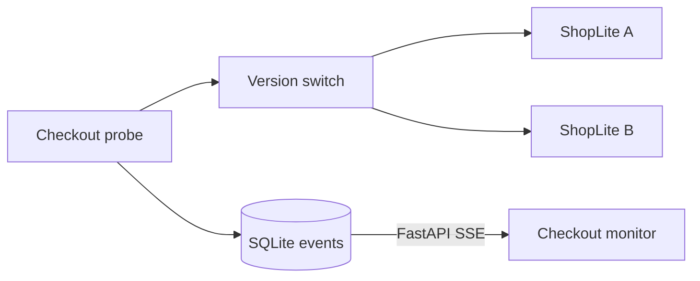

# PHOENIX

PHOENIX is ALTF4's hackathon project for recovering a demo shop from a checkout outage. The planned incident flow restores checkout on the last healthy revision, investigates the failure, verifies a candidate repair, and waits for approval before release.

The starter runs two ShopLite slots, a traffic switch, a synthetic checkout probe, and a dashboard. Each probe is written to SQLite and streamed to the browser. Both slots run the starter checkout, and no API keys are needed for this milestone.

## Quickstart

1. From the repository root, build and start the services. Compose waits for all five services to pass their health checks.

   ```sh
   docker compose up --build --wait
   docker compose ps
   ```

2. Open [the dashboard](http://localhost:3000). Wait for the latest checkout to show **Passing** and the active slot to show **A**.
3. In another PowerShell window, switch to slot B. The next probe should still pass and show **B**.

   ```powershell
   $body = '{"active_slot":"b"}'
   Invoke-RestMethod http://127.0.0.1:8080/state -Method Put -ContentType 'application/json' -Body $body
   ```

Run `docker compose down` to stop the services. The `incident-data` volume retains the probe history. To change the starting slot or probe interval, copy `.env.example` to `.env` and edit the values.

### Docker Engine in Ubuntu on Windows

If Docker Engine and the Compose plugin are installed in `Ubuntu-24.04` under WSL 2, run these commands from the repository root in PowerShell.

```powershell
wsl -d Ubuntu-24.04 -u root -- docker compose up --build --wait
wsl -d Ubuntu-24.04 -u root -- docker compose ps
```

The dashboard is available at [localhost:3000](http://localhost:3000). The PowerShell slot-switch command in the quickstart also works with the WSL setup. To stop the services, run `wsl -d Ubuntu-24.04 -u root -- docker compose down`.

### Run without Docker

With Python 3.11 and Node.js 24 available, install the locked dependencies once from the repository root.

```powershell
python -m venv .venv
.\.venv\Scripts\python.exe -m pip install -r services/requirements.lock
npm --prefix services/shoplite ci
npm --prefix apps/dashboard ci
```

Run each row in its own PowerShell window from the repository root.

| Service | Command |
| --- | --- |
| ShopLite A | `$env:PORT = '3001'; $env:SHOP_REVISION = 'starter-a'; npm --prefix services/shoplite start` |
| ShopLite B | `$env:PORT = '3002'; $env:SHOP_REVISION = 'starter-b'; npm --prefix services/shoplite start` |
| Version switch | `.\.venv\Scripts\python.exe -m uvicorn version_switch.api:app --app-dir services --port 8080` |
| Brain | `.\.venv\Scripts\python.exe -m uvicorn brain.api:app --app-dir services --port 8000` |
| Dashboard | `npm --prefix apps/dashboard run dev` |

## Project layout



| Path | Purpose |
| --- | --- |
| `services/shoplite/` | Node.js 24 and Express checkout service, run in slots A and B |
| `services/version_switch/` | Independent FastAPI service that routes checkout to the active slot |
| `services/brain/` | Python 3.11 probe, SQLite event store, and FastAPI event stream |
| `apps/dashboard/` | Next.js 16, TypeScript, and Tailwind dashboard |
| `compose.yaml` | Local service definitions, startup checks, ports, and the SQLite volume |

ShopLite and the dashboard use their npm lockfiles. The switch and brain use the Python dependencies in `services/requirements.lock`.

Run the checkout regression check locally with Node.js 24.

```sh
npm --prefix services/shoplite ci
npm --prefix services/shoplite test
```

## Local endpoints

| URL | Purpose |
| --- | --- |
| [localhost:3000](http://localhost:3000) | Checkout monitor |
| `POST /checkout` on `127.0.0.1:8080` | Demo checkout through the active slot |
| `GET /state` and `PUT /state` on `127.0.0.1:8080` | Inspect and manually change the active slot |
| [127.0.0.1:8000/docs](http://127.0.0.1:8000/docs) | Brain API, including the `/events` server-sent event stream |

The sample checkout accepts `{"sku":"demo-mug","quantity":1}` and returns a total and revision. Each `checkout.probe` event includes a timestamp, the outcome, HTTP status, latency, slot, and revision when available.

## Development workflow

Use `Arsh` for feature development. Commit each reviewable change on that branch. Merge reviewed work into `main` when the feature is ready.

```sh
git switch Arsh
git status
git add <changed-files>
git commit -m "Describe the feature"
```

The next milestone is to open an incident after three consecutive failed checkout probes, preserve the broken revision, and restore the healthy slot. That establishes the flow the investigators, repair agent, and verifier will build on.
