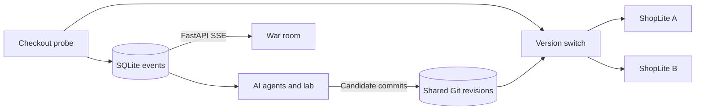

# PHOENIX

A judge breaks checkout on a running shop, and PHOENIX restores service on the last healthy version before anyone looks for the cause. AI agents then find the cause and write a fix, and an independent verifier proves it: the same check fails on the broken version and passes on the fix. A person approves the release, and PHOENIX writes the incident report from its own recorded events.

| Agent | What it does | Tools |
| --- | --- | --- |
| Coordinator | Weighs the two findings and picks the remedy | None |
| Code Investigator | Finds the commit that broke checkout | Git log, diff and show, bisect through the lab |
| Runtime Investigator | Explains the failure from runtime signals | Logs, config diff, web search |
| Repair Agent | Writes a minimal fix on a candidate branch | Candidate branch files, unit tests |
| Verifier | Proves or rejects a candidate, without seeing how it was made | Lab replay, its own regression test |

Monitoring, restore, release and the report are plain code.

## Quickstart

1. From the repository root, build and start the services. Compose waits for all five services to pass their health checks.

   ```sh
   docker compose up --build --wait
   docker compose ps
   ```

2. Open [the dashboard](http://localhost:3000). Wait for the status to show **Healthy** and the live slot to show **A**.
3. In another terminal, switch to slot B. The next probe should still pass and show **B**.

   ```sh
   curl -X PUT 127.0.0.1:8080/state -H 'Content-Type: application/json' -d '{"active_slot":"b"}'
   ```

   ```powershell
   $body = '{"active_slot":"b"}'
   Invoke-RestMethod http://127.0.0.1:8080/state -Method Put -ContentType 'application/json' -Body $body
   ```

Run `docker compose down` to stop the services. The `incident-data` volume retains the probe history. To change the starting slot or probe interval, copy `.env.example` to `.env` and edit the values.

## Demo setup

1. Use an up-to-date local `main`. The version switch takes its first healthy version from it.

   ```sh
   git switch main
   git pull --ff-only
   git fetch origin fault/bad-checkout
   git rev-parse origin/fault/bad-checkout
   ```

2. Copy `.env.example` to `.env` and fill in these values.

   | Key | Value |
   | --- | --- |
   | `GEMINI_API_KEY` or `ANTHROPIC_API_KEY` | The key for the models named in `MODEL_FAST` and `MODEL_STRONG` |
   | `TAVILY_API_KEY` | Web search. Without it, search falls back to Tavily's rate-limited keyless mode |
   | `PHOENIX_BAD_REV` | The SHA that `git rev-parse` printed above |

   The fault branch is only ever deployed by the demo. Never merge it.

3. Build the images once, with ports 3000, 8000 and 8080 free.

   ```sh
   docker compose build
   ```

## Run the demo

1. Start from a healthy shop. This **deletes this project's incident history and candidate fixes**.

   ```sh
   ./scripts/reset.sh
   ```

2. Open [localhost:3000](http://localhost:3000). The recorded story, with no live services, is at [localhost:3000/?mock=1](http://localhost:3000/?mock=1).
3. Press **BREAK** on the dashboard, or send the request.

   ```sh
   curl -X POST 127.0.0.1:8000/chaos/break -H 'Content-Type: application/json' -d '{"fault":"bad_commit"}'
   ```

   ```powershell
   Invoke-RestMethod http://127.0.0.1:8000/chaos/break -Method Post -ContentType 'application/json' -Body '{"fault":"bad_commit"}'
   ```

4. After checkout is restored, submit a flawed fix as the judge. The verifier must reject it. On a free model tier, wait for **Fix verified** first, because both checks share one rate limit.

   ```sh
   curl -X POST 127.0.0.1:8000/chaos/bad-candidate
   ```

   ```powershell
   Invoke-RestMethod http://127.0.0.1:8000/chaos/bad-candidate -Method Post
   ```

5. Press **Approve release** when a fix is verified, or send its candidate ID. Approving anything else returns 409.

   ```sh
   curl 127.0.0.1:8000/incidents/current
   curl -X POST 127.0.0.1:8000/incidents/<incident-id>/approve -H 'Content-Type: application/json' -d '{"candidate_id":"<incident-id>-c1"}'
   ```

   ```powershell
   Invoke-RestMethod http://127.0.0.1:8000/incidents/current
   Invoke-RestMethod http://127.0.0.1:8000/incidents/<incident-id>/approve -Method Post -ContentType 'application/json' -Body '{"candidate_id":"<incident-id>-c1"}'
   ```

6. Press **View report**. To run the demo again, go back to step 1.

### Docker Engine in Ubuntu on Windows

If Docker Engine and the Compose plugin are installed in `Ubuntu-24.04` under WSL 2, run these commands from the repository root in PowerShell.

```powershell
wsl -d Ubuntu-24.04 -u root -- docker compose up --build
```

Keep that PowerShell window open while you use the dashboard at [localhost:3000](http://localhost:3000). The attached Compose session keeps Ubuntu running. In another PowerShell window, use `wsl -d Ubuntu-24.04 -u root -- docker compose ps` to check health. The PowerShell slot-switch command in the quickstart also works with the WSL setup. To stop the services, run `wsl -d Ubuntu-24.04 -u root -- docker compose down`.

### Run without Docker

With Python 3.11 and Node.js 24 available, install the locked dependencies once from the repository root.

```powershell
python -m venv .venv
.\.venv\Scripts\python.exe -m pip install -r services/requirements.lock
npm --prefix services/shoplite ci
npm --prefix apps/dashboard ci
```

Run each row in its own PowerShell window from the repository root.

| Service | Command |
| --- | --- |
| ShopLite A | `$env:PORT = '3001'; $env:SHOP_REVISION = 'starter-a'; npm --prefix services/shoplite start` |
| ShopLite B | `$env:PORT = '3002'; $env:SHOP_REVISION = 'starter-b'; npm --prefix services/shoplite start` |
| Version switch | `.\.venv\Scripts\python.exe -m uvicorn version_switch.api:app --app-dir services --port 8080` |
| Brain | `.\.venv\Scripts\python.exe -m uvicorn brain.api:app --app-dir services --port 8000` |
| Dashboard | `npm --prefix apps/dashboard run dev` |

## Project layout



| Path | Purpose |
| --- | --- |
| `services/shoplite/` | Node.js 24 and Express checkout service, run in slots A and B |
| `services/version_switch/` | Independent FastAPI service that routes checkout to the active slot |
| `services/brain/` | Python 3.11 probe, incident engine, release runner, AI agents, lab and report |
| `apps/dashboard/` | Next.js 16, TypeScript, and Tailwind war room |
| `scripts/reset.sh` | Returns the demo to a healthy shop |
| `compose.yaml` | Local service definitions, startup checks, ports, and the SQLite volume |

ShopLite and the dashboard use their npm lockfiles. The switch and brain use the Python dependencies in `services/requirements.lock`.

Run the tests locally with Node.js 24 and the Python environment from [Run without Docker](#run-without-docker).

```sh
npm --prefix services/shoplite ci
npm --prefix services/shoplite test
cd services && python -m pytest tests brain/tests version_switch/tests
```

## Local endpoints

| URL | Purpose |
| --- | --- |
| [localhost:3000](http://localhost:3000) | War room |
| `POST /checkout` on `127.0.0.1:8080` | Demo checkout through the active slot |
| `GET /state` and `PUT /state` on `127.0.0.1:8080` | Inspect and manually change the active slot |
| [127.0.0.1:8000/docs](http://127.0.0.1:8000/docs) | Brain API, including the `/events` server-sent event stream |

The sample checkout accepts `{"sku":"demo-mug","quantity":1}`, optionally with `"discount":{"code":"SAVE10"}`, and returns a total and revision. The probe alternates carts with and without the discount. Each `checkout.probe` event includes a timestamp, the outcome, HTTP status, latency, slot, revision and cart total.

## Development workflow

Use one branch per person, open pull requests into `main`, and never force-push.

```sh
git switch -c <your-branch> origin/main
git add <changed-files>
git commit -m "Describe the feature"
git push -u origin <your-branch>
```
